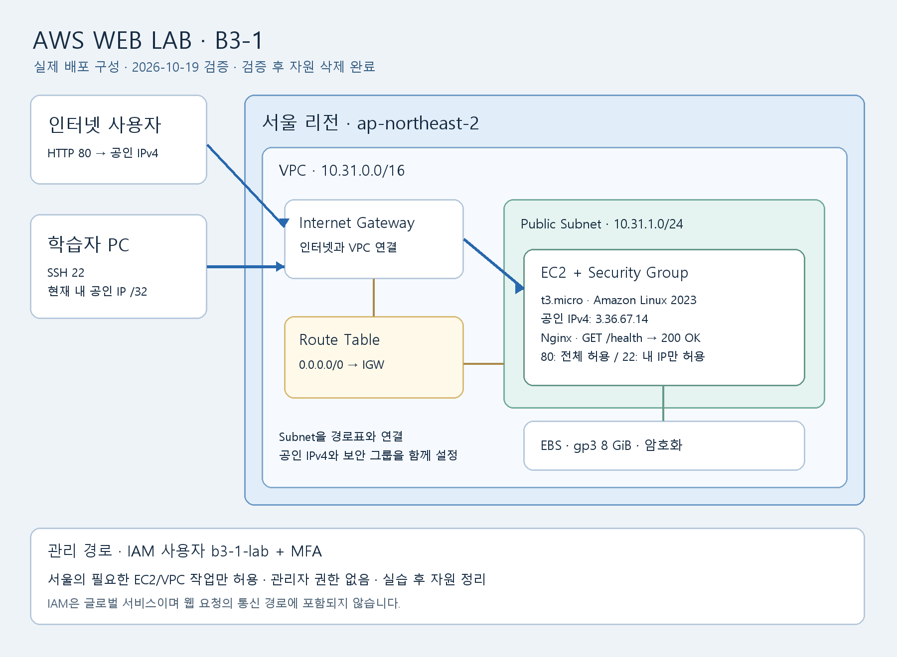

# Codyssey B3-1 — AWS Web Lab

서울 리전의 VPC와 EC2 한 대에 Nginx 웹 서버를 배포하고, 외부 접속·최소권한·문제 해결·리소스 정리를 증빙하는 개인 과제입니다.

저장소: https://github.com/mov-hyun/b3-1-aws-web

필수 외부 검증은 **B — 공인 IP의 GET /health → 200·OK**입니다. 과제 원문은 A/B 중 하나를 선택하도록 합니다. [방식 선택과 브라우저 관찰 기록](docs/browser-verification.md)에 실제 결과를 정리했습니다. 아키텍처는 제출용 PNG와 같은 구성의 [Markdown 설명·경로도](docs/architecture.md)도 제공합니다.

2026-10-21 추가 결과: **HTTPS·Docker 보너스 검증·증빙 저장·자원 정리 완료**. 기존 필수 실습의 검증·정리 기록은 보존합니다.

## HTTPS·Docker 보너스 — 2026-10-21

서울 EC2 한 대에서 공식 Caddy 컨테이너와 무료 sslip.io 서브도메인·Let's Encrypt 인증서를 사용했습니다. NAT·Elastic IP·로드 밸런서·RDS·유료 도메인은 만들지 않았습니다.

- 이미지: `caddy:2-alpine`을 내려받고 `caddy@sha256:d8542f48d34a9cf4e4c11a478865229840e87e4c96ea3f439101f31a5d35f75f`로 고정해 실행. Caddy 2.11.7, Docker CLI 25.0.14.
- 실행 방식: [생성 스크립트](scripts/build_bonus_user_data.py)의 EC2 user-data에서 `docker run --detach --name b3-1-bonus-web --restart unless-stopped` 실행. 정적 파일·Caddyfile은 읽기 전용 마운트, 인증서 데이터는 Docker 볼륨에 보관. [전체 실행 명령](docs/bonus.md#docker-실행-결과).
- 포트 매핑: **호스트 TCP 80 → 컨테이너 80, 호스트 TCP 443 → 컨테이너 443**. SSH 22는 내 IP /32만 허용.
- 12:53:39~40 KST 내부 `http://localhost` 및 `/health` 200, Docker Up, 아웃바운드 HTTPS 200 확인.
- 외부 검증 방식 **B**: `GET http://3.34.131.100/health` → **200, 본문 OK**.
- HTTPS: `https://bonus-movhyun.3.34.131.100.sslip.io/health` → **200, 본문 OK**. curl 인증서 검증 결과 0, 별도 신뢰 CA·호스트 이름 검사 통과, TLS 1.3. 실제 HTTPS 페이지의 브라우저 표시도 확인.
- [원본 서버 로그](docs/logs/bonus-server-verification.txt), [외부 응답·인증서 로그](docs/logs/bonus-external-verification.txt), [상세 결과와 복구 과정](docs/bonus.md), [별도 자원 추적](docs/bonus-resources.json).

[실제 HTTPS 웹페이지 스크린샷](docs/screenshots/bonus-https-page.png)을 보관했습니다. 최초 상태 확인의 타이밍 오류로 cloud-init은 error로 남았으며, 재시도를 보완하고 서비스·응답·TLS 검증을 완료했습니다. 실패 기록은 [트러블슈팅 보고서](docs/troubleshooting.md)에 보존합니다.

**보너스 서버는 종료·삭제됐습니다.** 2026-10-21 13:01:49 KST EC2 종료를 요청했고, 13:06:29 KST 최종 종료 상태와 EBS·키 페어·보너스 네트워크 삭제·IP 반환을 확인했습니다. 위 IP와 서브도메인은 과거 검증 정보이며 재접속하지 않습니다. 증빙은 보관한 로그와 스크린샷으로 확인합니다. [정리 근거](docs/cleanup-checklist.md).

## 필수 실습 완료 기록 — 2026-10-19

- 2026-10-19 AWS 무료 플랜과 USD 100 크레딧, 서울 리전 선택 확인. 당시 확인한 금액이며 현재 잔액은 별도로 조회하지 않았습니다.
- 2026-10-19 루트 계정의 패스키 MFA 1개 등록을 콘솔에서 확인.
- 웹페이지·Nginx 설정·EC2 user-data·아키텍처 PNG·과제용 IAM 정책 준비.
- 로컬 단위 검사 4개와 Bash 문법 검사 통과. 브라우저에서 정적 웹페이지 레이아웃 확인.
- AWS에 고객 관리형 정책 `B31LabEC2Seoul`, `B31LabOwnMFA` 생성 확인.
- `b3-1-lab`의 연결 정책 3개와 관리자 권한 미부여를 확인했습니다. 인증 앱 MFA로 재로그인하고 서울 EC2/VPC 조회·생성에 성공했습니다.
- VPC·Subnet·IGW·기본 경로·Subnet 연결·보안 그룹을 생성했습니다. 2026-10-19 19:34 KST EC2 `i-0f0e25192b43a666e` 한 대를 생성했습니다.
- 19:37 KST SSH·Nginx 실행·localhost 200·아웃바운드 HTTPS 200·외부 `/health` 200 및 `OK`를 확인했습니다. 설치 중 발생한 curl 패키지 충돌과 복구 과정을 기록했습니다.
- **실습 자원 정리 완료.** EC2 종료, EBS 0개, VPC·IGW·Subnet·Route Table·Security Group·AWS 키 페어 삭제를 확인했습니다. Elastic IP·NAT·ENI 잔여 0개. 상세 시각과 근거는 [정리 체크리스트](docs/cleanup-checklist.md)에 기록했습니다.



## 외부 접속 검증

선택 방식: **B — `GET http://<퍼블릭IP>/health`**.

- 실제 URL: `http://3.36.67.14/health`
- 검증 시각: **2026-10-19 19:37:35 KST** (`10:37:35 UTC`)
- 실제 응답: **HTTP `200 OK`, 본문 `OK`**
- [원본 응답 로그](docs/logs/external-health.txt), [검증 문서](docs/evidence.md)
- **현재 서버는 종료·삭제됐습니다.** 2026-10-19 19:45:35 KST 종료, 공인 IP 반환 완료. 위 URL은 과거 검증 주소이며 이후 다른 자원에 재할당될 수 있습니다. 현재 접속 기록은 보관한 원본 응답 로그로 확인합니다.

## 구성과 범위

- 서울 `ap-northeast-2`, VPC `10.31.0.0/16`, Public Subnet `10.31.1.0/24`.
- Internet Gateway와 `0.0.0.0/0 → IGW` 라우팅.
- `t3.micro` 한 대, Amazon Linux 2023, 암호화된 gp3 8 GiB, 자동 할당 공인 IPv4.
- HTTP TCP 80은 `0.0.0.0/0`, SSH TCP 22는 학습자 현재 공인 IP `/32`로 제한.
- 직접 만든 네트워크 자원과 키 페어에 `Project=b3-1`, `Name` 태그 부여. 인스턴스·루트 볼륨·네트워크 인터페이스에 `Project=b3-1` 적용. VPC 자동 생성 기본 자원은 해당 VPC의 종속 자원으로 추적.
- NAT Gateway, Elastic IP, ALB/ELB, RDS, 유료 도메인은 생성하지 않습니다.
- IAM은 글로벌 서비스이므로 화면에 `Global` 또는 `us-east-1`이 표시될 수 있습니다. EC2/VPC 등 지역 자원은 서울에만 생성합니다.
- 필수 실습은 2026-10-19 완료했습니다. HTTPS·Docker 보너스는 2026-10-21 별도 EC2에서 실제 검증했습니다. 각 실습의 식별자와 정리 상태는 별도로 기록합니다.

## 보안·운영 판단

HTTP 80의 `0.0.0.0/0`는 모든 IPv4 출발지에 웹 포트를 공개합니다. 외부 접속 과제 검증을 위한 설정이며, 자동 스캔·취약점 공격·과도한 요청과 HTTP 평문의 도청·변조 위험이 있습니다. SSH 22는 내 IP /32로 제한했고, 전체 포트 공개 규칙은 만들지 않았습니다. 두 실습 모두 증빙 확보 후 공개 자원을 삭제했습니다. [공개 목적·기간·허용 IP/VPN/ALB 대안](docs/operations.md)에 판단 근거를 기록했습니다.

SG는 포트·소스 등 네트워크 통신을, IAM은 사용자의 AWS API 작업·자원·조건을 통제합니다. 외부 접속 장애는 라우팅 → SG → 현재 공인 IP → 서버 상태 → 외부 재검증 순서로 점검하고, 관리 API 권한 오류는 사용자·MFA·리전·태그·정책에서 조사합니다.

패키지 설치·이미지 다운로드·인증서 발급에는 서버가 시작하는 아웃바운드 연결이 필요합니다. SG는 허용한 요청의 응답을 상태에 따라 허용합니다. 병목 지표, ALB 도입 조건, 태그 기반 비용 추적·알림·증가 시 대응은 [보안·운영 계획](docs/operations.md)에 정리했습니다. 확장 구성과 비용 알림은 향후 계획이며, 이번에 만들거나 성능을 측정한 결과로 표시하지 않습니다.

## 로컬 준비 검증

Python 표준 라이브러리만으로 배포 스크립트를 생성하고 검증합니다.

```powershell
python scripts/build_user_data.py
python -m unittest discover -s tests -v
```

`.local/user-data.sh`는 EC2 생성 화면의 고급 세부 정보 → 사용자 데이터에 입력할 파일입니다. 이 명령은 AWS 자원을 생성하지 않습니다. 아키텍처 PNG 재생성에는 개발 도구 Pillow와 Windows의 맑은 고딕 폰트가 필요합니다. 배포 스크립트 생성과 단위 검사는 Python 표준 라이브러리만 사용합니다.

```powershell
python scripts/render_architecture.py
```

## 문서

- [제출 전 검토 결과](docs/review.md)
- [요구사항과 증빙 매핑](docs/requirements.md)
- [MFA와 최소권한 IAM](docs/account-setup.md)
- [배포 순서](docs/deploy-guide.md)
- [아키텍처 PNG](docs/architecture.png)
- [아키텍처 Markdown·트래픽 경로](docs/architecture.md)
- [실제 검증 증빙](docs/evidence.md)
- [방식 B와 브라우저 관찰 기록](docs/browser-verification.md)
- [보안·장애 점검·확장·비용 대응](docs/operations.md)
- [트러블슈팅](docs/troubleshooting.md)
- [리소스 정리 체크리스트](docs/cleanup-checklist.md)
- [리소스 상태](docs/resources.json)

개인키, 비밀번호, 액세스 키, MFA QR·비밀키·인증 코드와 비공개 계정 화면은 저장소에 올리지 않습니다. 기존 B7-1의 코드·Git 설정·Render 서비스는 이 프로젝트에서 변경하지 않습니다.
