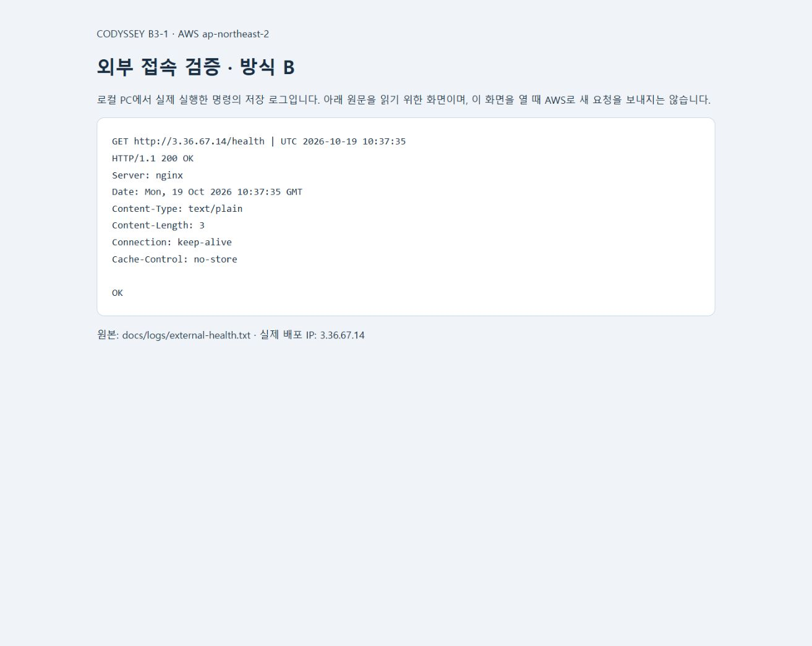

# Codyssey B3-1 — AWS Web Lab

서울 리전의 VPC와 EC2 한 대에 Nginx 웹 서버를 배포하고, 외부 접속·최소권한·문제 해결·리소스 정리를 증빙하는 개인 과제입니다.

저장소: https://github.com/mov-hyun/b3-1-aws-web

## 현재 진행 상태

- AWS 무료 플랜과 USD 100 크레딧, 서울 리전 선택 확인.
- 2026-10-19 루트 계정의 패스키 MFA 1개 등록을 콘솔에서 확인.
- 웹페이지·Nginx 설정·EC2 user-data·아키텍처 PNG·과제용 IAM 정책 준비.
- 로컬 단위 검사 4개와 Bash 문법 검사 통과. 브라우저에서 정적 웹페이지 레이아웃 확인.
- AWS에 고객 관리형 정책 `B31LabEC2Seoul`, `B31LabOwnMFA` 생성 확인.
- `b3-1-lab`의 연결 정책 3개와 관리자 권한 미부여를 확인했습니다. 인증 앱 MFA로 재로그인하고 서울 EC2/VPC 조회·생성에 성공했습니다.
- VPC·Subnet·IGW·기본 경로·Subnet 연결·보안 그룹을 생성했습니다. 2026-10-19 19:34 KST EC2 `i-0f0e25192b43a666e` 한 대를 생성했습니다.
- 19:37 KST SSH·Nginx 실행·localhost 200·아웃바운드 HTTPS 200·외부 `/health` 200 및 `OK`를 확인했습니다. 설치 중 발생한 curl 패키지 충돌과 복구 과정을 기록했습니다.
- **실습 자원 정리 완료.** EC2 종료, EBS 0개, VPC·IGW·Subnet·Route Table·Security Group·AWS 키 페어 삭제를 확인했습니다. Elastic IP·NAT·ENI 잔여 0개. 상세 시각과 근거는 [정리 체크리스트](docs/cleanup-checklist.md)에 기록했습니다.


## 외부 접속 검증

선택 방식: **B — `GET http://<퍼블릭IP>/health`**.

- 실제 URL: `http://3.36.67.14/health`
- 검증 시각: **2026-10-19 19:37:35 KST** (`10:37:35 UTC`)
- 실제 응답: **HTTP `200 OK`, 본문 `OK`**
- [원본 응답 로그](docs/logs/external-health.txt), [검증 문서](docs/evidence.md)
- **현재 서버는 종료·삭제됐습니다.** 2026-10-19 19:45:35 KST 종료, 공인 IP 반환 완료. 위 URL은 과거 검증 주소이며 이후 다른 자원에 재할당될 수 있습니다. 현재 접속 증빙은 보관한 로그와 스크린샷으로 확인합니다.



스크린샷은 로컬 PC의 실제 `curl` 결과를 원문 그대로 표시한 로그 뷰어입니다. 방식 B의 HTTP 응답 증빙이며, 브라우저 페이지 표시 방식 A는 제출 방식에 포함하지 않습니다.

## 구성과 범위

- 서울 `ap-northeast-2`, VPC `10.31.0.0/16`, Public Subnet `10.31.1.0/24`.
- Internet Gateway와 `0.0.0.0/0 → IGW` 라우팅.
- `t3.micro` 한 대, Amazon Linux 2023, 암호화된 gp3 8 GiB, 자동 할당 공인 IPv4.
- HTTP TCP 80은 `0.0.0.0/0`, SSH TCP 22는 학습자 현재 공인 IP `/32`로 제한.
- 직접 만든 네트워크 자원과 키 페어에 `Project=b3-1`, `Name` 태그 부여. 인스턴스·루트 볼륨·네트워크 인터페이스에 `Project=b3-1` 적용. VPC 자동 생성 기본 자원은 해당 VPC의 종속 자원으로 추적.
- NAT Gateway, Elastic IP, ALB/ELB, RDS, 유료 도메인은 생성하지 않습니다.
- IAM은 글로벌 서비스이므로 화면에 `Global` 또는 `us-east-1`이 표시될 수 있습니다. EC2/VPC 등 지역 자원은 서울에만 생성합니다.
- 우선 필수 과제를 완성합니다. HTTPS·Docker 보너스는 현재 범위에 포함하지 않습니다.

## 로컬 준비 검증

Python 표준 라이브러리만으로 배포 스크립트를 생성하고 검증합니다.

```powershell
python scripts/build_user_data.py
python -m unittest discover -s tests -v
```

`.local/user-data.sh`는 EC2 생성 화면의 고급 세부 정보 → 사용자 데이터에 입력할 파일입니다. 이 명령은 AWS 자원을 생성하지 않습니다. 아키텍처 PNG 재생성에는 개발 도구 Pillow와 Windows의 맑은 고딕 폰트가 필요합니다. 배포 스크립트 생성과 단위 검사는 Python 표준 라이브러리만 사용합니다.

```powershell
python scripts/render_architecture.py
```

## 문서

- [제출 전 검토 결과](docs/review.md)
- [요구사항과 증빙 매핑](docs/requirements.md)
- [MFA와 최소권한 IAM](docs/account-setup.md)
- [배포 순서](docs/deploy-guide.md)
- [아키텍처 PNG](docs/architecture.png)
- [실제 검증 증빙](docs/evidence.md)
- [트러블슈팅](docs/troubleshooting.md)
- [리소스 정리 체크리스트](docs/cleanup-checklist.md)
- [리소스 상태](docs/resources.json)

개인키, 비밀번호, 액세스 키, MFA QR·비밀키·인증 코드와 비공개 계정 화면은 저장소에 올리지 않습니다. 기존 B7-1의 코드·Git 설정·Render 서비스는 이 프로젝트에서 변경하지 않습니다.
