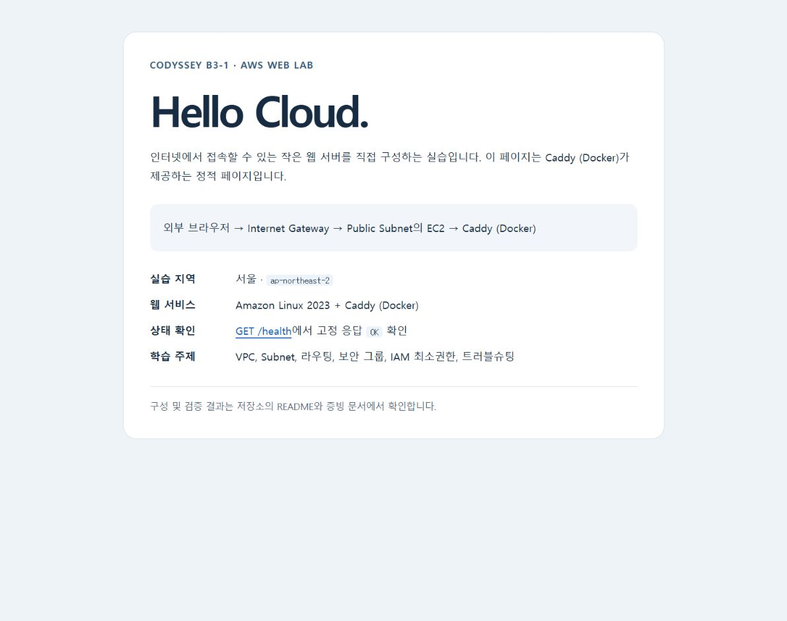

# HTTPS·Docker 보너스 실습

현재 상태: **2026-10-21 Docker·HTTPS 검증 및 보너스 AWS 자원 정리 완료**.

10월 19일 필수 실습의 증빙과 정리 기록은 그대로 보존합니다. 이번 보너스는 별도 EC2 한 대로 다시 검증하며 식별자와 삭제 상태는 bonus-resources.json에 기록합니다.

## 이번 배포의 식별자

| 항목 | 실제 생성 값 |
|---|---|
| EC2 / 시작 시각 | i-082daaa8d2788b50a / 2026-10-21 12:43:46 KST |
| AMI | ami-06a87fea194ac0452, Amazon Linux 2023 x86_64 |
| VPC / Subnet | vpc-004d02de3da12a529 / subnet-00f11a9f0ebce0473 |
| IGW / Route Table | igw-07cffc3e7fc836831 / rtb-0df7c8ad8b088e88c |
| Security Group | sg-0333206b881d6b9cb, 인바운드 TCP 80·443 전체 / 22 운영자 IP /32 |
| 루트 EBS | vol-04de2b59d35d57f23, gp3 8 GiB, 암호화·종료 시 삭제 확인 |
| 키 페어 | b3-1-bonus-key, 기존 PEM의 공개키 재등록 |
| 자동 공인 IP | 3.34.131.100 |
| 무료 서브도메인 | bonus-movhyun.3.34.131.100.sslip.io |

SSH 연결 전에 AWS 시스템 로그의 ED25519 지문 `SHA256:5c+MHURQk+masvKfYpOQXWtSn/UcZylox7UpjXNIR0U`를 조회한 키와 대조했습니다. 일치 확인 후 StrictHostKeyChecking=yes로 접속했습니다.

## 비용을 줄이는 구성

- 기존 무료 플랜을 유지하고 서울에서 t3.micro 한 대, 암호화된 gp3 8 GiB를 사용합니다. 실제 생성 직전에 계정 상태와 선택한 사양을 확인합니다.
- 공인 IPv4 한 개를 자동 할당합니다. EIP·NAT·ALB·RDS·유료 도메인은 생성하지 않습니다.
- `bonus-movhyun.<실제 공인 IP>.sslip.io`의 무료 DNS와 Let's Encrypt 인증서를 사용합니다. 실제 DNS 해석과 인증서 검증 성공 후 완료로 기록합니다.
- 실행 시간을 줄이도록 배포 파일을 먼저 준비합니다. 증빙 저장 후 생성한 AWS 자원을 정리합니다.

## Docker 실행 결과

공식 이미지 `caddy:2-alpine`을 가져온 뒤 RepoDigest를 확인해 해당 digest로 실행했습니다. 실제 실행 이미지는 `caddy@sha256:d8542f48d34a9cf4e4c11a478865229840e87e4c96ea3f439101f31a5d35f75f`입니다. Docker CLI는 25.0.14, Caddy는 2.11.7로 확인했습니다.

| 항목 | 설정 |
|---|---|
| 컨테이너 | b3-1-bonus-web |
| 포트 매핑 | 호스트 TCP 80 → 컨테이너 80, 호스트 TCP 443 → 컨테이너 443 |
| HTTP | 공인 IP와 localhost의 /health에 200, 본문 OK |
| HTTPS | 무료 서브도메인에 신뢰 가능한 Let's Encrypt 인증서 적용 |
| 정적 파일·설정 | /srv와 /etc/caddy/Caddyfile에 읽기 전용 바인드 마운트 |
| 인증서 저장 | Docker 이름 있는 볼륨의 /data, /config. 인증서 개인키는 저장소에 복사하지 않음 |
| 관리 인터페이스 | Caddy admin off. Docker 소켓과 관리자 포트를 외부에 공개하지 않음 |
| SSH | 학습자 실행 시점 공인 IP /32만 허용 |

HTTP에서 200을 직접 확인해야 하는 과제 요구사항을 유지하기 위해 자동 HTTPS 리디렉션만 비활성화합니다. 인증서 자동 발급과 TLS 검증은 활성 상태입니다.

최초 컨테이너 실행 명령 기록입니다. 두 변수는 서버에서 생성한 domain.txt와 image-digest.txt의 값을 사용했습니다.

```bash
docker run --detach --name b3-1-bonus-web --restart unless-stopped \
  --publish 80:80 --publish 443:443 \
  --env SITE_DOMAIN="$SITE_DOMAIN" \
  --mount type=bind,src=/opt/b3-1-bonus/site,dst=/srv,readonly \
  --mount type=bind,src=/opt/b3-1-bonus/Caddyfile,dst=/etc/caddy/Caddyfile,readonly \
  --mount type=volume,src=b3-1-bonus-caddy-data,dst=/data \
  --mount type=volume,src=b3-1-bonus-caddy-config,dst=/config \
  "$CADDY_IMAGE"
```

docker ps에 함께 표시되는 `2019/tcp`, `443/udp`는 이미지의 EXPOSE 메타데이터입니다. 호스트 포트로 공개한 것은 TCP 80과 443뿐이며 docker port 결과에도 이 두 개만 나타납니다. Caddy 관리자 API는 껐고 HTTP/3도 사용하지 않습니다.

## 준비 명령

```powershell
python scripts/build_bonus_user_data.py
python -m unittest discover -s tests -v
```

생성된 .local/bonus-user-data.sh를 EC2 사용자 데이터로 사용합니다. 로컬 생성 명령 자체는 AWS 자원을 만들지 않습니다. 원래 Nginx HTML은 보존하고 Caddy용 문구로 바꾼 사본을 컨테이너에 배포합니다.

## 실제 검증 결과

검증 시각: **2026-10-21 12:53:39~40 KST** (`03:53:39~40 UTC`). 원본은 [서버 검증 로그](logs/bonus-server-verification.txt)와 [외부 검증 로그](logs/bonus-external-verification.txt)에 보관했습니다.

| 항목 | 실제 결과 |
|---|---|
| Docker | 서비스 active, 컨테이너 Up |
| 서버 내부 | GET http://localhost → 200, GET http://localhost/health → 200 및 본문 OK |
| 아웃바운드 | https://example.com → 200 |
| 외부 HTTP, 방식 B | GET http://3.34.131.100/health → 200, 본문 OK 2 bytes |
| DNS | bonus-movhyun.3.34.131.100.sslip.io → 3.34.131.100 |
| 외부 HTTPS | GET https://bonus-movhyun.3.34.131.100.sslip.io/health → 200, 본문 OK |
| TLS | curl 검증 결과 0, 별도 Python 기본 CA·호스트 이름 검사 통과, TLS 1.3 |
| 인증서 | Let's Encrypt YE1, SAN이 실습 서브도메인과 일치. 만료 2027-01-19 02:51:04 UTC |
| 브라우저 | 실제 HTTPS 루트 페이지와 /health 표시 성공. 보안 경고 우회 없음 |

공인 IP는 임시 주소입니다. 실습 자원 정리 후 URL은 과거 기록으로만 사용하며, 반환된 IP에 재접속하지 않습니다.

### 스크린샷



위 이미지는 실제 HTTPS 웹페이지를 브라우저에서 연 화면입니다.

## 시작 직후 상태 확인 오류와 복구

최초 user-data의 curl이 컨테이너 시작 직후 `52 Empty reply from server`로 종료돼 cloud-init은 error로 남았습니다. Docker 설치·Caddy 설정 검사는 성공했고 컨테이너는 Up 상태였습니다. 원래 실패 기록은 [부트스트랩 로그](logs/bonus-bootstrap-troubleshooting.txt)에 보존했습니다.

상태 확인에 `--retry-all-errors`, 재시도 12회, 간격 2초, 재시도 시간 한도 45초와 요청별 10초 제한을 적용했습니다. Caddy 설정의 고정 본문도 정확한 `OK`로 맞췄습니다. 컨테이너 재시작 직후 curl 56 연결 재설정이 실제 발생했으나 보완한 재시도가 200으로 회복하는 것을 확인했습니다. 이후 내부·외부 응답과 인증서를 다시 검증했습니다.

기존 cloud-init 실패 상태를 성공으로 덮어쓰지 않았습니다. 새 EC2에서 수정된 user-data 전체를 다시 실행하는 검증은 하지 않았으며, 수정한 설정의 실제 Caddy 검사와 재시도·서비스 복구, 로컬 단위 검사 6개·Bash 문법 검사를 완료했습니다. 최종 생성 user-data는 5,036 bytes입니다.

## 정리 상태

사용자 승인 후 13:01:49 KST EC2 종료를 요청했고, 13:06:29 KST 최종 종료 상태와 EBS·키 페어·보너스 네트워크 삭제·공인 IP 반환을 확인했습니다. 서울 EBS·Elastic IP·NAT·ENI 목록은 0개, VPC 목록에는 기존 기본 VPC 한 개만 남았습니다. [정리 체크리스트](cleanup-checklist.md)와 bonus-resources.json에 실제 근거와 시각을 기록했습니다. 현재 서버 URL은 운영 중인 서비스 주소가 아니며 재접속하지 않습니다.

무료 서브도메인은 IP를 해석하는 공개 DNS 방식이므로 별도 DNS 계정·API 토큰·유료 도메인 자원은 생성하지 않았습니다. 컨테이너의 인증서 데이터도 루트 EBS와 함께 삭제됐습니다. 최종 청구 금액·잔여 크레딧은 IAM 권한 제한으로 미확인입니다.

## 공식 근거

- https://nip.io/ — sslip.io DNS와 HTTP-01 인증서 안내
- https://caddyserver.com/docs/running#docker-compose — 공식 컨테이너와 데이터 볼륨
- https://caddyserver.com/docs/caddyfile/options#auto-https — 인증서 자동화와 리디렉션 제어
- https://docs.aws.amazon.com/AmazonECS/latest/developerguide/create-container-image.html — AL2023 Docker 설치
- https://docs.aws.amazon.com/awsaccountbilling/latest/aboutv2/free-tier-plans.html — 무료 플랜과 크레딧
- https://curl.se/docs/manpage.html#--retry-all-errors — 상태 확인 GET의 제한된 오류 재시도
